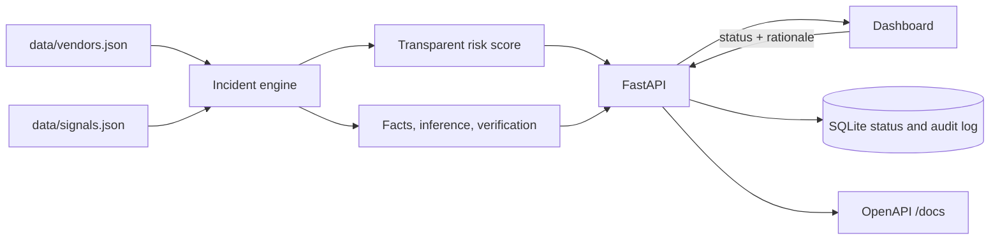

# Vanguard

[](https://github.com/vishnuendla/Vanguard/actions/workflows/ci.yml)

**Vendor disruption intelligence that shows its work.**

Vanguard is a working MVP for procurement and vendor-risk teams. It turns scattered supplier signals into one prioritized review queue, keeps reported facts separate from inferred impact, and records every human decision with a rationale and an audit trail.

The project is intentionally narrow: one polished supplier-disruption workflow, synthetic data, and no autonomous actions. The goal is to make the evidence, the uncertainty, and the decision path visible rather than hide them behind a black-box score.

> **Data notice:** the included vendors and signals are synthetic. Source links use `example.com` and are placeholders, not live reporting. Risk scores are transparent demo heuristics, not forecasts, probabilities, or confirmed financial loss.

## Why this exists

Supplier risk rarely arrives as one clean alert. An analyst gets a port bulletin, a carrier update, a contract note, and a shipment exception in different formats and at different times. The difficult questions are:

- What is actually reported, and by which source?
- Which open orders and locations are exposed?
- What is still unverified?
- Who decided what to do, and why?
- Can we reconstruct that decision later?

Vanguard models that workflow end to end. Every incident links back to dated evidence, separates **reported facts** from **inferred impact**, lists **verification steps**, and writes a human decision to an append-only audit trail.

## What the MVP does

- Aggregates vendor signals into one incident per vendor.
- Ranks incidents with a transparent, bounded risk score.
- Shows source evidence with publication dates and URLs.
- Separates reported facts, potential impact, and verification needs.
- Lets an analyst mark an incident `reviewed`, `relevant`, or `dismissed` with a required rationale.
- Records who changed the status, what it changed from, and why.
- Exposes a JSON API with interactive OpenAPI docs.
- Ships with a dependency-free dark dashboard, tests, CI, and a container build.

## What it deliberately does not do

- It does not connect to live news, ERP, shipment, email, contract, or LLM services.
- It does not send supplier emails, create tickets, or execute procurement actions.
- It does not claim the risk score is a probability or a financial forecast.
- It does not provide production authentication, SSO, or multi-tenant isolation.
- It does not replace an analyst. It prepares evidence for one.

## Demo scenario

The synthetic feed contains four vendors:

| Vendor | Category | Why it is in the queue |
|---|---|---|
| Northstar Logistics | Freight and logistics | Terminal outage plus two rerouted containers |
| Apex Components | Electronic components | Regional power-conservation advisory |
| Solstice Energy | Utilities | Contract renewal unconfirmed |
| Meridian Packaging | Packaging | Planned maintenance window |

Open **Northstar Logistics** first. The incident combines two signals: a port equipment outage and a shipment reroute. The detail view shows both source records, the reported facts, the open-order exposure as **context rather than loss**, approved alternatives, and the checks an analyst should complete before acting.

The highest-priority incident currently scores **86 / 99**. That number is deliberately explainable:

```text
risk = min(99, round(severity_weight × 0.72 + exposure_ratio × 12 + criticality_bonus))
```

- `severity_weight` is the strongest source severity for that vendor (0–100).
- `exposure_ratio` is the vendor's open-order exposure divided by the largest exposure in the monitored vendor file, capped at 1.
- `criticality_bonus` is 15 for critical, 10 for high, 5 for medium, and 0 for low.

Confidence is the mean confidence attached to the evidence records. The UI keeps score, confidence, and exposure separate so none of them masquerades as certainty.

## How it works



1. `app/engine.py` loads the vendor and signal files, groups signals by vendor, and builds one incident per vendor with at least one signal.
2. The engine scores and sorts incidents, then attaches evidence, reported facts, inferred impacts, affected locations, and verification steps.
3. `app/database.py` stores the triage status and append-only audit events in SQLite. It uses WAL mode, a busy timeout, and deterministic connection cleanup.
4. `app/main.py` exposes authenticated endpoints, validates payloads, adds security headers, and serves the dashboard.
5. The dashboard calls the API, renders the queue and evidence detail, and sends status changes with the analyst's rationale.
6. Repeating an incident's current status returns `409` instead of writing a misleading `new → new` audit entry.

### Triage states

| Status | Meaning |
|---|---|
| `new` | No human decision recorded yet |
| `reviewed` | An analyst inspected the evidence without changing priority |
| `relevant` | Confirmed as material and worth follow-up |
| `dismissed` | Reviewed and judged not actionable |

Every transition is recorded with actor, old status, new status, rationale, and UTC timestamp.

## Quick start

Requires **Python 3.12+** and Git.

### Windows PowerShell

```powershell
git clone https://github.com/vishnuendla/Vanguard.git
cd Vanguard

py -3.12 -m venv .venv
.\.venv\Scripts\Activate.ps1
python -m pip install -r requirements-dev.txt
Copy-Item .env.example .env
uvicorn app.main:app --reload
```

### macOS / Linux

```bash
git clone https://github.com/vishnuendla/Vanguard.git
cd Vanguard

python3.12 -m venv .venv
source .venv/bin/activate
python -m pip install -r requirements-dev.txt
cp .env.example .env
uvicorn app.main:app --reload
```

Open **http://127.0.0.1:8000**. Interactive API documentation is at **http://127.0.0.1:8000/docs**.

The local demo token is `local-demo-token`. The dashboard loads it automatically when the app is using the demo configuration. If `VANGUARD_API_TOKEN` is set to a different value, the UI asks for that token instead.

Production installs only need `requirements.txt`:

```bash
pip install -r requirements.txt
uvicorn app.main:app --host 0.0.0.0 --port 8000
```

### Container

```bash
docker build -t vanguard .
docker run --rm -p 8000:8000 -e VANGUARD_API_TOKEN=replace-with-a-long-random-value vanguard
```

The image runs as an unprivileged user, stores SQLite under `/app/data`, and includes a health check.

## Verify it locally

Use this five-minute checklist after starting the server:

1. **Health:** open `/api/health` and confirm `{"status":"ok","service":"vanguard"}`.
2. **Queue:** open `/` and confirm four incidents load, with Northstar Logistics at the top.
3. **Evidence:** select Northstar. Confirm two source records, a reported-facts panel, a separate potential-impact/inference panel, and a verification checklist.
4. **Decision:** add a note such as `Two shipments need a recovery ETA.` and click **Mark relevant**. The status pill should change and the audit section should show the decision.
5. **Audit:** switch to the **Relevant** filter and confirm the incident remains visible.
6. **Conflict handling:** click **Reviewed**, then click **Reviewed** again. The API should return `409` and the dashboard should show a conflict message instead of writing a duplicate audit entry.
7. **API docs:** open `/docs`, authorize with `local-demo-token`, and try `GET /api/incidents`.

### API examples

Set `VANGUARD_TOKEN` to the token configured for your instance. The local demo token is `local-demo-token`.

PowerShell:

```powershell
$env:VANGUARD_TOKEN = "local-demo-token"

$headers = @{
  Authorization = "Bearer $env:VANGUARD_TOKEN"
  "X-User-Id"  = "analyst-01"
}

Invoke-RestMethod http://127.0.0.1:8000/api/incidents -Headers $headers |
  Select-Object vendor_name, risk_score, severity, status

$body = @{
  status    = "relevant"
  rationale = "Two shipments need a recovery ETA."
} | ConvertTo-Json

Invoke-RestMethod `
  -Method Patch `
  -Uri http://127.0.0.1:8000/api/incidents/inc-northstar-logistics/status `
  -Headers $headers `
  -ContentType "application/json" `
  -Body $body
```

curl:

```bash
export VANGUARD_TOKEN=local-demo-token
AUTH_HEADER="Authorization: Bearer $VANGUARD_TOKEN"

curl -s http://127.0.0.1:8000/api/incidents \
  -H "$AUTH_HEADER" \
  -H 'X-User-Id: analyst-01'

curl -s -X PATCH http://127.0.0.1:8000/api/incidents/inc-northstar-logistics/status \
  -H "$AUTH_HEADER" \
  -H 'X-User-Id: analyst-01' \
  -H 'Content-Type: application/json' \
  -d '{"status":"relevant","rationale":"Two shipments need a recovery ETA."}'
```

To reset the demo, stop the server and delete `data/vanguard.db` (plus any `-wal`/`-shm` files). The next start recreates the tables and all incidents return to `new`.

## API

Protected endpoints require:

```text
Authorization: Bearer <token>
X-User-Id: <analyst-id>
```

| Method | Endpoint | Purpose |
|---|---|---|
| `GET` | `/api/health` | Public liveness check |
| `GET` | `/api/config` | Demo-only token hint; never returns a deployment token |
| `GET` | `/api/incidents` | Prioritized queue; optional `?status=new` |
| `GET` | `/api/incidents/{id}` | Incident with evidence and verification needs |
| `PATCH` | `/api/incidents/{id}/status` | Triage update with required rationale |
| `GET` | `/api/audit` | Review history; optional `?incident_id=...&limit=...` |
| `GET` | `/api/vendors` | Synthetic monitored vendor list |

`limit` is bounded to 200. Rationale is trimmed and must be 3–500 characters. Repeating the current status returns `409`.

## Configuration

| Variable | Default | Purpose |
|---|---|---|
| `VANGUARD_API_TOKEN` | `local-demo-token` | Bearer token for API access |
| `VANGUARD_DATABASE_PATH` | `data/vanguard.db` | SQLite database location |

Values are loaded from `.env` in the project root. Do not commit `.env` or real supplier data. Set a unique random token and use a managed secret store before exposing the service to a network.

## Security model

This is a portfolio MVP, not a production identity system. The current controls are deliberately explicit:

- Bearer-token comparison uses a constant-time check.
- The demo token is disclosed only when the app is using the known demo configuration.
- `X-User-Id` is self-asserted and must be replaced with SSO-issued identity in production.
- Status values are a fixed enum; rationale is length-validated; SQL values are parameterized.
- Audit records are append-only through the API.
- Responses set `X-Content-Type-Options`, `X-Frame-Options`, `Referrer-Policy`, and `Permissions-Policy`.
- Evidence URLs must use `http` or `https`.
- SQLite connections are closed deterministically; WAL mode reduces reader/writer contention.
- The container runs as a non-root user, and `.dockerignore` keeps local environments, tests, and databases out of the build context.

Not included: SSO, RBAC, tenant isolation, rate limiting, CSRF protection for cookie auth, managed secrets, and centralized audit storage. Those are required before real deployment.

## Quality gates

```bash
ruff format --check .
ruff check .
pytest
bandit -r app -q
pip-audit -r requirements.txt
docker build -t vanguard:local .
```

CI runs the same checks on pull requests to `dev` and `main`, plus Gitleaks secret scanning and a container build. Dependabot checks Python and GitHub Actions dependencies. The suite currently has **20 tests** covering authentication, secret non-disclosure, security headers, rationale validation, invalid filters, status conflicts, audit ordering and limits, risk bounds, and unknown-vendor isolation.

## Project structure

| Path | Purpose |
|---|---|
| `app/main.py` | FastAPI routes, authentication, security headers |
| `app/engine.py` | Signal aggregation, scoring, evidence and inference assembly |
| `app/database.py` | SQLite triage state and append-only audit log |
| `app/schemas.py` | Validated API contracts |
| `data/` | Synthetic vendors and signals |
| `web/` | Dependency-free dashboard |
| `tests/` | API and engine regression tests |
| `.github/workflows/` | CI quality gates and container publishing |

## Limitations

- The dataset is synthetic and intentionally tiny.
- There is one incident per vendor, not one per event or shipment.
- Risk weights are fixed demo heuristics, not learned or calibrated models.
- There is no source freshness, deduplication, conflict detection, or ingestion pipeline.
- The queue is not paginated; suitable for a demo, not thousands of incidents.
- SQLite is single-node storage and the schema is created at startup rather than migrated.
- Authentication is a shared bearer token with a self-asserted actor header.
- The dashboard is optimized for a desktop operations view.

## Suggested next improvements

**Near term**

1. Add an ingestion layer with source freshness, duplicate detection, and per-source reliability.
2. Track evidence provenance at the fact level so a single sentence can be traced to a source span.
3. Add conflict detection when two sources disagree, and show the conflict explicitly.
4. Add incident history and signal-level updates instead of rebuilding incidents from static files.
5. Add an evaluation harness with a curated scenario set: evidence recall, risk-ranking quality, and time-to-decision.

**Before production**

6. Replace the shared token with SSO/OIDC and add role-based permissions for triage and audit access.
7. Move from SQLite to PostgreSQL with migrations, backups, and tenant isolation.
8. Add rate limiting, request IDs, structured logs, and centralized audit export.
9. Add an approval workflow for outbound actions such as supplier emails or ticket creation.
10. Add responsive and accessibility testing for the dashboard.

## Development workflow

- `main` is the stable branch; `dev` is integration.
- Feature and fix branches use conventional prefixes, e.g. `feat/live-source-connectors`, `fix/audit-pagination`, `docs/project-overview`.
- Commit subjects follow Conventional Commits, e.g. `feat: add source freshness indicator`.
- Open a PR to `dev`. Release changes move from `dev` to `main` through a reviewed PR after CI passes.

The UI and API are intentionally framework-light. The backend is FastAPI + Pydantic + SQLite; the frontend is plain HTML, CSS, and JavaScript.
